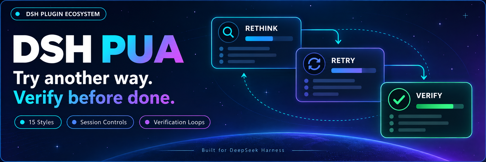
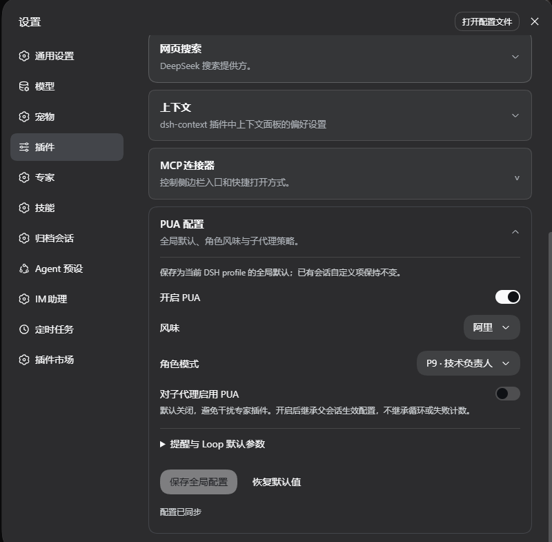
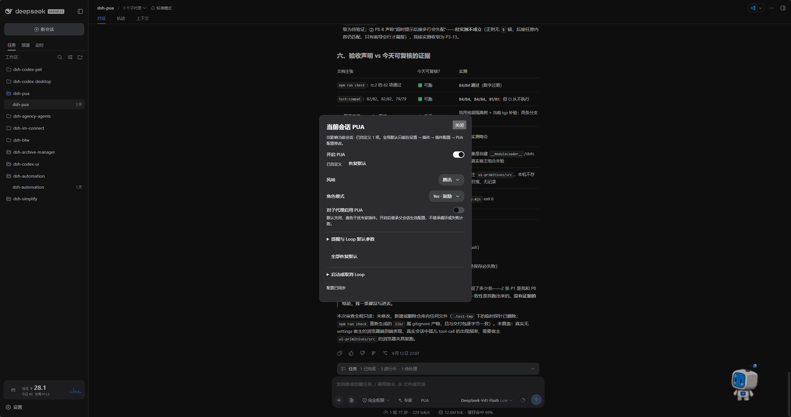

<p align="center">
  
</p>

<div align="center">

# DSH PUA

**Hilft Ihrem Agenten, einen anderen Ansatz zu versuchen und seine Arbeit zu überprüfen, bevor er sie als erledigt meldet**

[简体中文](README.zh-CN.md) · [English](README.en.md) · [日本語](README.ja.md) · [Español](README.es.md) · [Français](README.fr.md) · [Deutsch](README.de.md) · [Русский](README.ru.md) · [Português](README.pt.md)

[Änderungsprotokoll](CHANGELOG.md) · [Apache-2.0](LICENSE)

[](https://www.npmjs.com/package/@michengai/dsh-pua)
[](https://www.npmjs.com/package/@michengai/dsh-pua)
[](https://github.com/MichengAI/dsh-pua/actions/workflows/ci.yml)
[](LICENSE)
[](https://github.com/deepseek-ai/deepseek-harness)
[](https://nodejs.org/)

</div>

> DSH PUA bringt das Originalprojekt [PUA](https://github.com/tanweai/pua) zu DeepSeek Harness. Wenn ein Agent wiederholt scheitert, vorzeitig aufgibt oder eine Aufgabe ohne Verifizierung als erledigt meldet, leitet dieses Plugin ihn an, seine Denkweise zu hinterfragen, Fehlerursachen zu analysieren und überprüfbare Belege zu liefern. Ein von der Community gepflegtes Projekt; kein offizielles Produkt von DeepSeek AI oder PUA.

## Funktionsübersicht

- **Anderen Ansatz wählen**: Ermutigt den Agenten, seine Herangehensweise neu zu überdenken, statt wirkungslose Versuche zu wiederholen.
- **Ergebnisse vor Abschluss prüfen**: Fordert konkrete Überprüfungen und Nachweise ein und verhindert unberechtigte Erfolgsmeldungen.
- **15 Unternehmensstile & Rollen**: Bietet Stile bekannter Tech-Konzerne sowie Rollenmodi (P7, P9, P10, Lob, Fürsorglich).
- **Anpassungen über die Benutzeroberfläche**: Globale Einstellungen in der Plugin-Verwaltung speichern und Einzelsitzungen direkt über das Chat-Eingabefeld anpassen.
- **Fortsetzen bis zur erfolgreichen Verifikation (Loop)**: Startet eine Arbeitsschleife, die Korrekturen fortsetzt, bis die Verifikation erfolgreich ist, das Rundenlimit erreicht wird oder der Vorgang abgebrochen wird.
- **Integritätsschutz (Integrity Guard)**: Verhindert das Auslesen von verborgenen Benchmark-Lösungen (einschließlich Websuchen) und warnt vor Änderungen an Test-, Bewertungs- oder CI-Ressourcen.
- **Saubere Markdown-Tabellen**: Statusanzeigen, Fortschrittsübersichten und KPI-Karten nutzen GFM-Pipe-Tabellen anstelle von Unicode-Rahmenzeichen.

Die tatsächliche Wirkung hängt vom jeweiligen Modell und der Aufgabenstellung ab; das Plugin garantiert keine universelle Lösbarkeit.

## Screenshots

### Globale Einstellungen

Öffnen Sie in der Seitenleiste „Plugins“ und wählen Sie `@michengai/dsh-pua`, um Standardstatus, Stil, Persona und Richtlinien für Unteragenten festzulegen. Bei älteren DSH-Versionen klappen Sie „PUA-Konfiguration“ unter Einstellungen → Plugins auf.



### Einstellungen der aktuellen Sitzung

Klicken Sie im Composer rechts neben dem Experten-Menü auf **PUA**, um die laufende Konversation anzupassen. Sie können Standardwerte wiederherstellen oder Loops direkt im Bedienfeld starten und abbrechen.



## DSH-Produktökosystem

Für eine Desktop-Arbeitsumgebung laden Sie bitte [DSH Codex Desktop](https://github.com/MichengAI/dsh-codex-desktop/releases) herunter. Bei bestehendem [DeepSeek Harness](https://github.com/deepseek-ai/deepseek-harness) können Plugins gemäß der jeweiligen README installiert werden. Nachfolgend sind 11 eigens entwickelte Plugins aufgeführt; der tatsächliche Lieferumfang der Desktop-App richtet sich nach den jeweiligen Versionshinweisen.

| Plugin | Einsatzzweck |
| --- | --- |
| [Codex UI](https://github.com/MichengAI/dsh-codex-ui) | Projekte und Sitzungen organisieren, Aufgaben durchsuchen und Chat-Runden ansteuern |
| [Agency Agents](https://github.com/MichengAI/dsh-agency-agents) | Aufgabenspezifische Fachagenten auswählen und anfordern |
| [Skills Manager](https://github.com/MichengAI/dsh-skills-manager) | Lokale Fähigkeiten suchen, aktivieren, erstellen und importieren |
| [Archive Manager](https://github.com/MichengAI/dsh-archive-manager) | Archivierte Konversationen durchsuchen, wiederherstellen oder bereinigen |
| [IM Connect](https://github.com/MichengAI/dsh-im-connect) | Aufgaben über Messaging-Plattformen erteilen und Antworten empfangen |
| [Automation](https://github.com/MichengAI/dsh-automation) | Geplante Aufgaben ausführen und Ausführungsprotokolle einsehen |
| [BTW](https://github.com/MichengAI/dsh-btw) | Kontextbezogene Zwischenfragen stellen, ohne den Hauptlauf zu unterbrechen |
| [Simplify](https://github.com/MichengAI/dsh-simplify) | Mit `/simplify` geänderten Code im Git-Bereich bereinigen und vereinfachen |
| [PUA](https://github.com/MichengAI/dsh-pua) | Den Agenten anleiten, bei Fehlern Alternativen zu suchen und Ergebnisse zu prüfen |
| [Code Review](https://github.com/MichengAI/dsh-code-review) | Unabhängige Code-Reviews mit `/review` starten und den Bericht direkt im Chat erhalten |
| [Codex Pet](https://github.com/MichengAI/dsh-codex-pet) | Benachrichtigungen einsehen sowie Freigaben und Rückfragen über ein Desktop-Haustier steuern |

## Installation

Erfordert Node.js 22.19 oder neuer. Host-Kompatibilität: Vollständige DeepSeek Harness `0.2.x`-Reihe (`>=0.2.0-rc.1 <0.3.0-0`), getestet mit `0.2.0-rc.1`, `0.2.0-rc.2`, `0.2.1-rc.1`, `0.2.1-rc.2`, `0.2.1-rc.3`, `0.2.2-rc.1`, `0.2.2-rc.2`. Frühere Hosts vor `0.2.0-rc.1` werden nicht unterstützt. Inkompatible Änderungen der `0.3.0`-Generation werden über die Versionsgrenze abgefangen. Für `0.1.x`-Umgebungen installieren Sie bitte Plugin `0.3.28`. Vorhandene Einstellungen und Sitzungsverläufe bleiben erhalten. Es wird die bestehende Modellkonfiguration von DSH genutzt; kein zusätzlicher API-Schlüssel erforderlich.

Sowohl GitHub als auch npm enthalten das vorkompilierte `lib`-Verzeichnis. Führen Sie nach Quellcodeänderungen vor dem Commit `npm run build` aus.

Die nachfolgenden Befehle verwenden das Profil `web`. Passen Sie dieses an Ihr genutztes Profil an.

### Einen Agenten mit der Installation beauftragen

Senden Sie folgende Anweisung an einen Agenten mit Terminal-Zugriff auf Ihrem Rechner:

```text
Installiere @michengai/dsh-pua in meinem lokalen DSH-Web-Profil mit dsh plugin --profile web add @michengai/dsh-pua@latest --registry=https://registry.npmjs.org/. Prüfe, ob das Plugin korrekt lädt, und erkläre mir, wie ich die PUA-Einstellungen öffne.
```

### Manuelle Installation

```powershell
[Console]::OutputEncoding = [System.Text.Encoding]::UTF8
$OutputEncoding = [System.Text.Encoding]::UTF8
dsh plugin --profile web add @michengai/dsh-pua@latest --registry=https://registry.npmjs.org/
```

Warten Sie, bis laufende Aufgaben abgeschlossen sind, und laden Sie DSH neu oder starten Sie den Web-Dienst neu (ein reines Neuladen der Browserseite reicht nicht aus). Geben Sie `/pua help` ein, um die Bereitschaft zu prüfen.

## Verwendung

1. Öffnen Sie „Plugins“ in der Seitenleiste, wählen Sie `@michengai/dsh-pua` und öffnen Sie die Einstellungen. In älteren DSH-Versionen: Einstellungen → Plugins → PUA-Konfiguration.
2. Aktivieren Sie „PUA zulassen“, wählen Sie Stil und Persona und speichern Sie. Dies aktiviert lediglich den Befehl `/pua` und das Chat-Icon, ohne Prompts automatisch einzuschleusen.
3. Kehren Sie zum Chat zurück, aktivieren Sie die Sitzung mit `/pua on` oder über die Schaltfläche und senden Sie Ihre Aufgabe ab.

Der Indikator **PUA** erscheint rechts neben dem Experten-Menü im Composer. Ist die Konversation deaktiviert, zeigt das Symbol ein Ausschaltsymbol ohne durchgestrichenen Text. Bei globaler Deaktivierung wird die Schaltfläche vollständig verborgen.

## Konfiguration

**Der globale Schalter bestimmt lediglich, ob der Befehl `/pua` und das Chat-Icon verfügbar sind. Befehle und Eingaben betreffen ausschließlich die aktuelle Sitzung, die standardmäßig deaktiviert startet.**

Nach einem Upgrade kehren Sitzungen ohne explizite Konfiguration in den inaktiven Zustand zurück, um ungewollte Injektionen zu verhindern. Ausdrücklich aktivierte Sitzungen behalten ihre Einstellung bei.

| Option | Beschreibung |
| --- | --- |
| PUA zulassen | Steuert Befehl und Chat-Schaltfläche. Standardmäßig erlaubt; Deaktivierung blendet beides aus und verhindert Sitzungsaktivierungen |
| Sitzungsschalter | Standardmäßig aus. Aktiviert die Prompt-Injektion ausschließlich für den aktuellen Chat |
| Stil und Persona | Automatische Auswahl oder Festlegung auf einen bestimmten Firmenstil und Rollenmodus |
| UI-Sprache | Folgt automatisch der Host-Sprache oder wird fest auf Chinesisch / Englisch / Japanisch / Spanisch / Französisch / Deutsch / Russisch / Portugiesisch eingestellt |
| Für Unteragenten aktivieren | Standardmäßig aus; aktivieren, wenn auch Spezialisten und Subagents PUA nutzen sollen |
| Korrekturerinnerungen | Konfiguriert Terminal-Fehlerprüfung, Eskalation nach Fehlschlägen und Qualitätshinweise |
| Integritätsschutz | Standardmäßig aus; blockiert Lesezugriffe auf Benchmark-Antworten und warnt bei Änderungen an Tests oder CI |
| Feedback-Erinnerungen | Intervall für lokale Feedback-Aufforderungen; Daten verbleiben lokal |
| Loop-Standardwerte | Verifikationsbefehl, Zeitlimit in Sekunden und Rundenobergrenze |

### Bis zur Verifikation fortsetzen (Loop)

Geben Sie im PUA-Panel des Chats die Loop-Aufgabe, den Prüfbefehl und das Rundenlimit ein und starten Sie den Lauf. Weisen Sie den Agenten beispielsweise an, fehlschlagende Tests zu beheben, mit `npm test` zu verifizieren und nach maximal 10 Durchläufen anzuhalten.

Befehlseingabe:

```text
/pua loop "Fehlgeschlagene Tests beheben und Regressionsabdeckung ergänzen" --verify "npm test" --max-iterations 10
```

Zum Beenden geben Sie `/pua-cancel-loop` oder `/pua cancel-loop` ein. Ein Deaktivieren von PUA in der laufenden Sitzung bricht die Schleife ebenfalls ab.

## Häufige Befehle

Übliche Einstellungen lassen sich komfortabel über die Benutzeroberfläche bedienen; ein Auswendiglernen von Befehlen ist nicht zwingend erforderlich.

| Ziel | Befehl |
| --- | --- |
| PUA für diese Konversation aktivieren / deaktivieren | `/pua on`, `/pua off` |
| Firmenstil festlegen | `/pua flavor huawei` |
| Erneuten Versuch mit anderem Ansatz fordern | `/pua again` |
| Vollständigkeitsprüfung der Aufgabe verlangen | `/pua done-check` |
| Abnahmenachweise einfordern | `/pua evidence` |
| Änderungen begutachten ohne Code zu verändern | `/pua review` |
| Sitzung auf globale Standardwerte zurücksetzen | `/pua reset` |
| Verifikationsschleife (Loop) abbrechen | `/pua-cancel-loop`, `/pua cancel-loop` |
| Status oder vollständige Hilfe anzeigen | `/pua status`, `/pua help` |

## Sitzungsereignisse

Dieses Plugin verwendet keine benutzerdefinierten Ereignistypen, um Replay-Kompatibilitätsprobleme zu vermeiden. Gespeicherte Beobachtungen sind reguläre `user/message`-Ereignisse mit `role: "user"`. Zählen Sie menschliche Benutzerbeiträge nicht allein anhand von `type`.

Die Unterscheidung erfolgt über `data.source`:

| Ursprung | Aktuelle Hosts (Sitzungsformat 4+) | Ältere Hosts |
| --- | --- | --- |
| Laufzeitnotizen und gespeicherte Beobachtungen | `kind` ist `plugin:@michengai/dsh-pua/runtime` | `kind` ist `plugin`, `plugin` ist `@michengai/dsh-pua/runtime` |
| Über `/pua` übermittelte Warteschlangentexte | `kind` ist `plugin:@michengai/dsh-pua` | `kind` ist `plugin`, `plugin` ist `@michengai/dsh-pua` |

Echte Benutzernachrichten weisen `source.kind === "user"` auf.

## Deinstallation

```powershell
[Console]::OutputEncoding = [System.Text.Encoding]::UTF8
$OutputEncoding = [System.Text.Encoding]::UTF8
dsh plugin --profile web remove @michengai/dsh-pua
```

Laden Sie DSH neu, damit die Änderungen wirksam werden. Projektdateien und Konversationsverläufe bleiben vollständig erhalten.

## Lizenz und Danksagung

Abgeleitet von [tanweai/pua](https://github.com/tanweai/pua) 3.5.1. Der eigene Code dieses Projekts unterliegt der [Apache License 2.0](LICENSE). Die eingebundenen PUA-Ressourcen behalten ihre deklarierte MIT-Lizenz und Namensnennungen; siehe [NOTICE](NOTICE).
