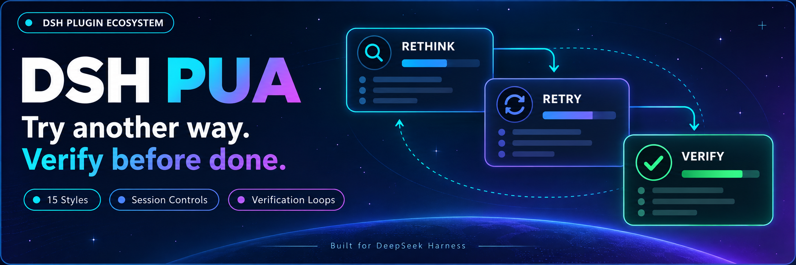
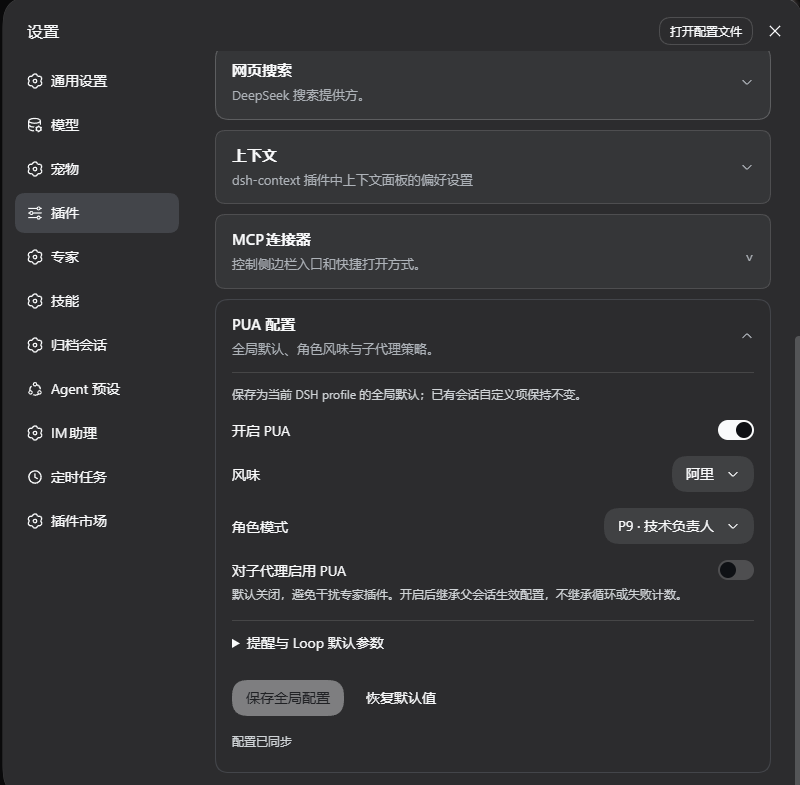
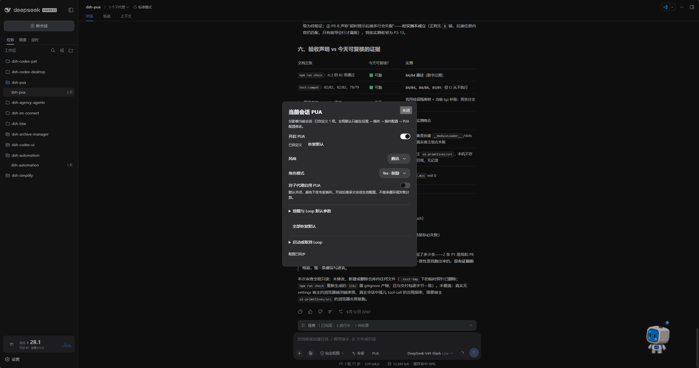

<p align="center">
  
</p>

<div align="center">

# DSH PUA

**Ayuda a tu agente a probar otro enfoque y verificar su trabajo antes de darlo por terminado**

[简体中文](README.zh-CN.md) · [English](README.en.md) · [日本語](README.ja.md) · [Español](README.es.md) · [Français](README.fr.md) · [Deutsch](README.de.md) · [Русский](README.ru.md) · [Português](README.pt.md)

[Registro de cambios](CHANGELOG.md) · [Apache-2.0](LICENSE)

[](https://www.npmjs.com/package/@michengai/dsh-pua)
[](https://www.npmjs.com/package/@michengai/dsh-pua)
[](https://github.com/MichengAI/dsh-pua/actions/workflows/ci.yml)
[](LICENSE)
[](https://github.com/deepseek-ai/deepseek-harness)
[](https://nodejs.org/)

</div>

> DSH PUA adapta el proyecto original [PUA](https://github.com/tanweai/pua) a DeepSeek Harness. Cuando un agente falla repetidamente, se rinde antes de tiempo o da una tarea por terminada sin comprobarla, lo guía para probar otra vía, investigar las causas y aportar evidencias verificables. Mantenido por la comunidad; no es un producto oficial de DeepSeek AI ni de PUA.

## Características

- **Cambiar de enfoque ante bloqueos**: Anima al agente a replantearse sus hipótesis en lugar de insistir en intentos fallidos.
- **Verificar antes de cerrar**: Exige comprobaciones y evidencias del resultado, evitando falsos positivos de finalización.
- **15 estilos corporativos y roles**: Incluye sabores inspirados en grandes tecnológicas, además de roles como P7, P9, P10, elogios o materno.
- **Ajustes visuales desde la interfaz**: Guarda la configuración global en las preferencias del complemento y ajusta sesiones individuales desde la barra de chat.
- **Continuar hasta superar la verificación (Loop)**: Inicia un bucle de trabajo que prosigue hasta pasar la prueba, alcanzar el límite de iteraciones o ser cancelado.
- **Barrera antitrampas (Integrity Guard)**: Bloquea lecturas directas o búsquedas web de respuestas ocultas en benchmarks, e inyecta advertencias antes de alterar pruebas, puntuaciones o CI.
- **Tablas Markdown limpias**: El estado, el progreso y las métricas KPI utilizan tablas GFM renderizables por DSH, sin recurrir a caracteres Unicode de dibujo de cajas.

El resultado final depende del modelo y la tarea concreta; el complemento no garantiza la resolución en todos los escenarios.

## Capturas

### Configuración global

Abre «Complementos» en la barra lateral y entra en `@michengai/dsh-pua` para definir el estado activo, sabor, rol y políticas de subagentes por defecto. En versiones anteriores de DSH, despliega «Configuración de PUA» dentro de Ajustes → Complementos.



### Configuración de la sesión actual

Haz clic en **PUA** a la derecha del selector de Expertos en el compositor para ajustar la conversación en curso. Puedes restablecer valores predeterminados o iniciar y cancelar bucles Loop desde este panel.



## Ecosistema de productos DSH

Si deseas una estación de trabajo de escritorio, descarga [DSH Codex Desktop](https://github.com/MichengAI/dsh-codex-desktop/releases). Si ya dispones de un entorno [DeepSeek Harness](https://github.com/deepseek-ai/deepseek-harness), puedes instalar complementos individualmente según el README de cada repositorio. A continuación se listan 11 complementos desarrollados por la iniciativa; consulta las notas de versión de la aplicación de escritorio para comprobar los paquetes preinstalados.

| Complemento | Qué puedes hacer |
| --- | --- |
| [Codex UI](https://github.com/MichengAI/dsh-codex-ui) | Organizar proyectos y sesiones, buscar tareas y navegar por turnos de chat |
| [Agency Agents](https://github.com/MichengAI/dsh-agency-agents) | Seleccionar e invocar especialistas adaptados a cada tarea |
| [Skills Manager](https://github.com/MichengAI/dsh-skills-manager) | Buscar, activar, crear e importar habilidades locales |
| [Archive Manager](https://github.com/MichengAI/dsh-archive-manager) | Buscar, restaurar o limpiar conversaciones archivadas |
| [IM Connect](https://github.com/MichengAI/dsh-im-connect) | Enviar tareas y recibir respuestas desde plataformas de mensajería |
| [Automation](https://github.com/MichengAI/dsh-automation) | Programar tareas periódicas y revisar los resultados de cada ejecución |
| [BTW](https://github.com/MichengAI/dsh-btw) | Hacer preguntas contextuales sin interrumpir la tarea principal |
| [Simplify](https://github.com/MichengAI/dsh-simplify) | Usar `/simplify` para refactorizar y simplificar cambios en Git |
| [PUA](https://github.com/MichengAI/dsh-pua) | Guiar al agente a buscar alternativas tras fallos e insistir en verificar resultados |
| [Code Review](https://github.com/MichengAI/dsh-code-review) | Ejecutar revisiones de código independientes con `/review` en la conversación actual |
| [Codex Pet](https://github.com/MichengAI/dsh-codex-pet) | Ver avisos y gestionar aprobaciones de herramientas mediante una mascota de escritorio |

## Instalación

Requiere Node.js 22.19 o posterior. Compatible con toda la gama DeepSeek Harness `0.2.x` (`>=0.2.0-rc.1 <0.3.0-0`), verificado en `0.2.0-rc.1`, `0.2.0-rc.2`, `0.2.1-rc.1`, `0.2.1-rc.2`, `0.2.1-rc.3` hasta `0.2.2-rc.1`. Los entornos anteriores a `0.2.0-rc.1` no están soportados. Los cambios incompatibles de la generación `0.3.0` quedan filtrados por el rango de dependencias. Para entornos `0.1.x`, instala la versión `0.3.28`. Los datos y configuraciones se conservan. Utiliza la configuración de modelos de DSH sin requerir claves de API adicionales.

Tanto GitHub como npm contienen la compilación lista para ejecución en `lib`. Al modificar el código fuente, compila con `npm run build` antes de realizar commit.

Los siguientes comandos usan el perfil `web`. Sustitúyelo por el perfil que utilices.

### Pedir a un agente que lo instale

Envía esta indicación a un agente con acceso a la consola de tu equipo:

```text
Instala @michengai/dsh-pua en mi perfil web de DSH ejecutando dsh plugin --profile web add @michengai/dsh-pua@latest --registry=https://registry.npmjs.org/. Comprueba que el plugin cargue correctamente y explícame cómo abrir la configuración de PUA.
```

### Instalación manual

```powershell
[Console]::OutputEncoding = [System.Text.Encoding]::UTF8
$OutputEncoding = [System.Text.Encoding]::UTF8
dsh plugin --profile web add @michengai/dsh-pua@latest --registry=https://registry.npmjs.org/
```

Una vez finalizadas las tareas en curso, recarga DSH o reinicia el servicio Web (actualizar la página del navegador no es suficiente). Introduce `/pua help` para confirmar que el complemento está activo.

## Uso

1. Abre Complementos en la barra lateral, selecciona `@michengai/dsh-pua` y abre la configuración. En versiones anteriores, ve a Ajustes → Complementos → Configuración de PUA.
2. Activa «Permitir PUA», elige el sabor y el modo, y guarda. Esto habilita el comando `/pua` y el botón en el chat, sin inyectar prompts por sí solo.
3. En el chat, activa la sesión actual mediante `/pua on` o pulsando el botón de PUA, y envía tu tarea.

El indicador **PUA** se muestra a la derecha de Expertos en el compositor. Cuando la conversación actual está desactivada, adopta un icono de apagado. Si se desactiva globalmente, el botón se oculta por completo.

## Configuración

**El interruptor global solo determina si el comando `/pua` y el botón de chat están disponibles. Las modificaciones en el chat o por comando solo afectan a la sesión actual, que por defecto inicia apagada.**

Al actualizar desde versiones antiguas, las sesiones que no se configuraron explícitamente volverán a estar apagadas, evitando inyecciones involuntarias. Las sesiones modificadas mediante `/pua on` o el panel conservan su preferencia.

| Opción | Descripción |
| --- | --- |
| Permitir PUA | Controla el comando y el botón de chat. Permitido por defecto; si se desactiva, ambos se ocultan y se bloquea la activación en sesiones |
| Interruptor de sesión | Desactivado por defecto. Activa la inyección únicamente en la conversación actual |
| Sabor y modo | Permite seleccionar automáticamente o fijar un estilo corporativo y un rol |
| Idioma de interfaz | Sigue el idioma del sistema automáticamente o se fija en chino / inglés / japonés / español / francés / alemán / ruso / portugués |
| Habilitar en subagentes | Desactivado por defecto; actívalo si deseas que los subagentes también usen PUA |
| Recordatorios de corrección | Ajusta revisiones de terminal, escalado tras fallos y avisos de calidad |
| Barrera antitrampas | Desactivada por defecto; bloquea lecturas de respuestas de referencia y avisa al editar pruebas o CI |
| Recordatorios de valoración | Frecuencia de recordatorios locales; los datos no se suben a la red |
| Valores por defecto de Loop | Comando de verificación, tiempo límite en segundos y tope de iteraciones |

### Ejecutar hasta verificar (Loop)

En el panel de PUA del chat, introduce la tarea del bucle, el comando de comprobación y el tope de rondas. Por ejemplo, solicita resolver los fallos de un test, verificar con `npm test` y parar tras 10 intentos.

También puedes ejecutarlo por comando:

```text
/pua loop "Corrige los tests que fallan y añade cobertura de regresión" --verify "npm test" --max-iterations 10
```

Para detenerlo, escribe `/pua-cancel-loop` o `/pua cancel-loop`. Desactivar PUA en la sesión actual también cancela el bucle en curso (sin deshacer los cambios ya aplicados en disco).

## Comandos frecuentes

La configuración habitual se gestiona cómodamente desde la interfaz, por lo que no es imprescindible memorizar los comandos.

| Objetivo | Comando |
| --- | --- |
| Activar o desactivar PUA en esta conversación | `/pua on`, `/pua off` |
| Asignar un sabor de estilo | `/pua flavor huawei` |
| Pedir que reintente con otro enfoque | `/pua again` |
| Exigir verificación de finalización de tarea | `/pua done-check` |
| Solicitar evidencias de entrega | `/pua evidence` |
| Revisar cambios sin modificar código | `/pua review` |
| Restablecer valores globales para esta sesión | `/pua reset` |
| Cancelar un bucle Loop | `/pua-cancel-loop`, `/pua cancel-loop` |
| Ver estado o ayuda completa | `/pua status`, `/pua help` |

## Eventos de sesión

Este complemento no crea tipos de eventos personalizados para evitar problemas de compatibilidad en la reproducción de sesiones. Las notas inyectadas son eventos ordinarios `user/message` con `role: "user"`. No uses únicamente el campo `type` para contar turnos de usuario reales.

Se diferencian mediante `data.source`:

| Origen | Hosts modernos (formato de sesión 4+) | Hosts anteriores |
| --- | --- | --- |
| Observaciones de ejecución | `kind` es `plugin:@michengai/dsh-pua/runtime` | `kind` es `plugin`, `plugin` es `@michengai/dsh-pua/runtime` |
| Mensajes en cola tras `/pua` | `kind` es `plugin:@michengai/dsh-pua` | `kind` es `plugin`, `plugin` es `@michengai/dsh-pua` |

Los mensajes de usuarios humanos reales tienen `source.kind === "user"`.

## Desinstalación

```powershell
[Console]::OutputEncoding = [System.Text.Encoding]::UTF8
$OutputEncoding = [System.Text.Encoding]::UTF8
dsh plugin --profile web remove @michengai/dsh-pua
```

Reinicia DSH para aplicar los cambios. Los archivos del proyecto y el historial de conversaciones se conservan intactos.

## Licencia y créditos

Adaptado de [tanweai/pua](https://github.com/tanweai/pua) 3.5.1. El código original de este proyecto se publica bajo la [Licencia Apache 2.0](LICENSE). Los recursos PUA incluidos conservan su licencia MIT original y avisos de atribución; consulta [NOTICE](NOTICE) para más información.
