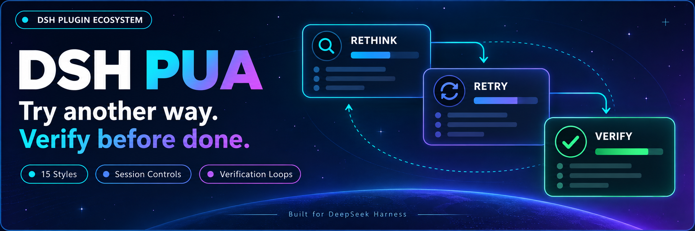
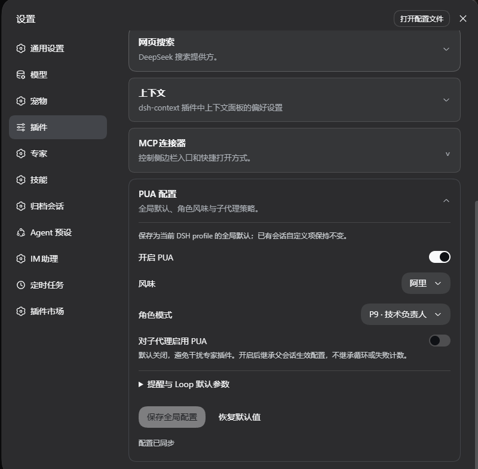
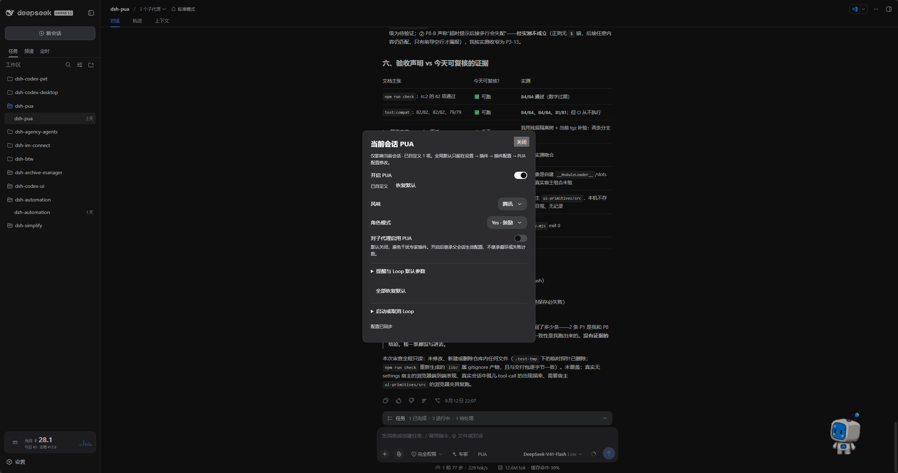

<p align="center">
  
</p>

<div align="center">

# DSH PUA

**Aide votre agent à essayer une autre approche et à vérifier son travail avant de le déclarer terminé**

[简体中文](README.zh-CN.md) · [English](README.en.md) · [日本語](README.ja.md) · [Español](README.es.md) · [Français](README.fr.md) · [Deutsch](README.de.md) · [Русский](README.ru.md) · [Português](README.pt.md)

[Journal des modifications](CHANGELOG.md) · [Apache-2.0](LICENSE)

[](https://www.npmjs.com/package/@michengai/dsh-pua)
[](https://www.npmjs.com/package/@michengai/dsh-pua)
[](https://github.com/MichengAI/dsh-pua/actions/workflows/ci.yml)
[](LICENSE)
[](https://github.com/deepseek-ai/deepseek-harness)
[](https://nodejs.org/)

</div>

> DSH PUA adapte le projet original [PUA](https://github.com/tanweai/pua) pour DeepSeek Harness. Lorsqu'un agent échoue de manière répétée, abandonne trop vite ou annonce une tâche terminée sans vérification, ce plugin l'invite à réévaluer sa méthode, à analyser les causes d'erreur et à fournir des preuves tangibles. Maintenu par la communauté ; n'est pas un produit officiel de DeepSeek AI ou de PUA.

## Fonctionnalités

- **Changer d'approche lors des blocages** : Incite l'agent à revoir son raisonnement au lieu de répéter des tentatives stériles.
- **Vérifier avant de conclure** : Exige des validations concrètes des résultats, évitant les faux positifs d'achèvement.
- **15 styles d'entreprise et personas** : Offre des styles inspirés des géants de la tech, ainsi que des personas (P7, P9, P10, encouragement, maternel).
- **Ajustements depuis l'interface** : Enregistrez les préférences globales dans les paramètres des plugins et modifiez chaque session directement depuis le chat.
- **Poursuivre jusqu'à validation (Loop)** : Lance une boucle de travail qui continue jusqu'à ce que les vérifications réussissent, que la limite de tours soit atteinte ou qu'elle soit interrompue.
- **Garde d'intégrité (Integrity Guard)** : Interdit la lecture directe ou via recherche web de réponses cachées dans les benchmarks, et avertit l'agent lors de modifications de tests, scores ou CI.
- **Tableaux Markdown soignés** : Les panneaux d'état, de progression et les indicateurs KPI s'affichent sous forme de tableaux GFM compatibles DSH, sans dessin Unicode de boîtes.

Les résultats dépendent du modèle utilisé et de la tâche ; le plugin ne garantit pas une solution systématique.

## Captures d'écran

### Paramètres globaux

Ouvrez « Plugins » dans la barre latérale, puis `@michengai/dsh-pua`, pour définir l'activation par défaut, le style, le persona et le comportement des sous-agents. Sur les versions antérieures de DSH, ouvrez « Configuration PUA » dans Paramètres → Plugins.



### Paramètres de la session actuelle

Cliquez sur **PUA** à droite du menu Experts dans la zone de saisie pour ajuster la conversation courante. Vous pouvez rétablir les valeurs par défaut ou lancer/interrompre des boucles Loop depuis ce volet.



## Écosystème des produits DSH

Pour un atelier de bureau complet, téléchargez [DSH Codex Desktop](https://github.com/MichengAI/dsh-codex-desktop/releases). Si vous disposez déjà d'un environnement [DeepSeek Harness](https://github.com/deepseek-ai/deepseek-harness), installez les plugins nécessaires en suivant le README de chaque dépôt. Voici 11 plugins développés par la communauté ; consultez les notes de version pour la liste exacte des composants intégrés.

| Plugin | Utilisation |
| --- | --- |
| [Codex UI](https://github.com/MichengAI/dsh-codex-ui) | Organiser projets et sessions, rechercher des tâches et naviguer dans l'historique |
| [Agency Agents](https://github.com/MichengAI/dsh-agency-agents) | Sélectionner et invoquer des spécialistes adaptés à chaque besoin |
| [Skills Manager](https://github.com/MichengAI/dsh-skills-manager) | Découvrir, activer, créer et importer des compétences locales |
| [Archive Manager](https://github.com/MichengAI/dsh-archive-manager) | Rechercher, restaurer ou nettoyer les conversations archivées |
| [IM Connect](https://github.com/MichengAI/dsh-im-connect) | Envoyer des tâches et recevoir des réponses depuis des messageries |
| [Automation](https://github.com/MichengAI/dsh-automation) | Planifier des tâches récurrentes et consulter les journaux d'exécution |
| [BTW](https://github.com/MichengAI/dsh-btw) | Poser des questions complémentaires sans interrompre la tâche active |
| [Simplify](https://github.com/MichengAI/dsh-simplify) | Utiliser `/simplify` pour rationaliser le code dans le périmètre Git |
| [PUA](https://github.com/MichengAI/dsh-pua) | Guider l'agent pour changer de méthode lors d'échecs et exiger une vérification |
| [Code Review](https://github.com/MichengAI/dsh-code-review) | Lancer une revue de code indépendante avec `/review` dans la conversation courante |
| [Codex Pet](https://github.com/MichengAI/dsh-codex-pet) | Consulter les notifications et répondre aux demandes d'approbation d'outils |

## Installation

Nécessite Node.js 22.19 ou une version ultérieure. Compatibilité hôte : Gamme complète DeepSeek Harness `0.2.x` (`>=0.2.0-rc.1 <0.3.0-0`), validée sur `0.2.0-rc.1`, `0.2.0-rc.2`, `0.2.1-rc.1`, `0.2.1-rc.2`, `0.2.1-rc.3`, `0.2.2-rc.1`, `0.2.2-rc.2`. Les versions antérieures à `0.2.0-rc.1` ne sont pas supportées. Les ruptures de compatibilité de la génération `0.3.0` sont interceptées par la gestion de versions. Pour les environnements `0.1.x`, installez le plugin `0.3.28`. Vos préférences et historiques de conversation sont conservés. Utilise la configuration de modèles existante de DSH, sans clé API supplémentaire.

GitHub et npm incluent tous deux le dossier compilé prêt à l'emploi `lib`. Après modification du code source, exécutez `npm run build` avant de commiter.

Les commandes suivantes ciblent le profil `web`. Adaptez selon le profil utilisé.

### Demander à un agent de l'installer

Transmettez ce texte à un agent pouvant exécuter des commandes sur votre machine :

```text
Installez @michengai/dsh-pua dans mon profil web local DSH en exécutant dsh plugin --profile web add @michengai/dsh-pua@latest --registry=https://registry.npmjs.org/. Vérifiez que le plugin se charge correctement et expliquez-moi comment ouvrir la configuration PUA.
```

### Installation manuelle

```powershell
[Console]::OutputEncoding = [System.Text.Encoding]::UTF8
$OutputEncoding = [System.Text.Encoding]::UTF8
dsh plugin --profile web add @michengai/dsh-pua@latest --registry=https://registry.npmjs.org/
```

Une fois les tâches courantes terminées, rechargez DSH ou redémarrez le service Web (recharger la page du navigateur ne suffit pas). Entrez `/pua help` pour vérifier que le plugin répond.

## Utilisation

1. Ouvrez Plugins dans la barre latérale, sélectionnez `@michengai/dsh-pua`, et ouvrez les réglages. Sur les versions antérieures de DSH, allez dans Paramètres → Plugins → Configuration PUA.
2. Activez « Autoriser PUA », sélectionnez le style et le persona souhaités, puis enregistrez. Cela active la commande `/pua` et le bouton dans le chat, sans injection automatique.
3. De retour dans le chat, activez la conversation en cours avec `/pua on` ou en cliquant sur le bouton PUA, puis soumettez votre demande.

L'indicateur **PUA** s'affiche à droite d'Experts dans le compositeur. Si la conversation active est désactivée, l'icône devient un symbole d'alimentation sans texte barré. Lorsque le plugin est désactivé globalement, le bouton est masqué.

## Configuration

**L'interrupteur global détermine uniquement si la commande `/pua` et le bouton du chat sont accessibles. Les commandes et actions du chat s'appliquent uniquement à la session courante, désactivée par défaut.**

Après mise à jour, les sessions sans configuration préalable reviennent à l'état désactivé pour éviter toute injection involontaire. Les sessions explicitement ajustées conservent leur état.

| Option | Description |
| --- | --- |
| Autoriser PUA | Contrôle la disponibilité de la commande et du bouton. Autorisé par défaut ; le désactiver masque l'accès et interdit l'activation individuelle |
| Interrupteur de session | Désactivé par défaut. Active l'injection uniquement pour la conversation courante |
| Style et persona | Permet une sélection automatique ou le choix d'un style d'entreprise et d'un rôle précis |
| Langue de l'interface | Suit la langue de l'hôte automatiquement ou se fixe sur chinois / anglais / japonais / espagnol / français / allemand / russe / portugais |
| Activer pour les sous-agents | Désactivé par défaut ; activez-le si les sous-agents spécialisés doivent aussi utiliser PUA |
| Rappels de correction | Ajuste le contrôle des erreurs terminal, l'escalade d'échecs et les avis qualité |
| Garde d'intégrité | Désactivé par défaut ; bloque la lecture de réponses de benchmarks et avertit en cas d'édition de tests ou de CI |
| Rappels d'avis | Règle la fréquence des rappels locaux ; les données ne sont pas transmises sur le réseau |
| Valeurs par défaut Loop | Commande de vérification, délai maximal en secondes et limite de tours |

### Poursuivre le travail jusqu'à validation (Loop)

Dans le volet PUA du chat, saisissez la tâche du Loop, la commande de validation et la limite de tours, puis lancez le traitement. Par exemple, demandez à l'agent de corriger les tests en échec, de vérifier via `npm test` et de s'arrêter après 10 tours maximum.

Vous pouvez également utiliser la commande :

```text
/pua loop "Corriger les tests en échec et ajouter une couverture de non-régression" --verify "npm test" --max-iterations 10
```

Pour arrêter le processus, saisissez `/pua-cancel-loop` ou `/pua cancel-loop`. La désactivation de PUA sur la session en cours interrompt également la boucle active.

## Commandes courantes

Les fonctionnalités usuelles sont gérées directement depuis l'interface ; la mémorisation des commandes est facultative.

| Objectif | Commande |
| --- | --- |
| Activer ou désactiver PUA pour cette conversation | `/pua on`, `/pua off` |
| Sélectionner un style d'entreprise | `/pua flavor huawei` |
| Demander d'essayer une autre méthode | `/pua again` |
| Vérifier si la tâche est réellement terminée | `/pua done-check` |
| Réclamer des preuves de validation | `/pua evidence` |
| Examiner les modifications sans éditer le code | `/pua review` |
| Rétablir les valeurs globales pour cette session | `/pua reset` |
| Interrompre une boucle de vérification Loop | `/pua-cancel-loop`, `/pua cancel-loop` |
| Afficher l'état ou l'aide complète | `/pua status`, `/pua help` |

## Événements de session

Ce plugin ne déclare aucun type d'événement propriétaire pour assurer une compatibilité parfaite lors de la relecture de sessions. Les observations enregistrées sont des événements classiques `user/message` avec `role: "user"`. Ne comptez pas les tours d'utilisateurs réels uniquement à partir du champ `type`.

La différenciation s'opère via `data.source` :

| Origine | Hôtes récents (format de session 4+) | Hôtes antérieurs |
| --- | --- | --- |
| Notes d'exécution et observations sauvegardées | `kind` vaut `plugin:@michengai/dsh-pua/runtime` | `kind` vaut `plugin`, `plugin` vaut `@michengai/dsh-pua/runtime` |
| Textes envoyés via `/pua` et mis en file d'attente | `kind` vaut `plugin:@michengai/dsh-pua` | `kind` vaut `plugin`, `plugin` vaut `@michengai/dsh-pua` |

Les messages envoyés par de véritables utilisateurs ont `source.kind === "user"`.

## Désinstallation

```powershell
[Console]::OutputEncoding = [System.Text.Encoding]::UTF8
$OutputEncoding = [System.Text.Encoding]::UTF8
dsh plugin --profile web remove @michengai/dsh-pua
```

Rechargez DSH pour appliquer les modifications. Les fichiers de vos projets et l'historique des conversations sont entièrement préservés.

## Licence et crédits

Adapté du projet [tanweai/pua](https://github.com/tanweai/pua) version 3.5.1. Le code propre à cette extension est distribué sous [Licence Apache 2.0](LICENSE). Les composants PUA intégrés conservent leur licence MIT et mentions d'attribution d'origine ; consultez [NOTICE](NOTICE) pour plus de détails.
