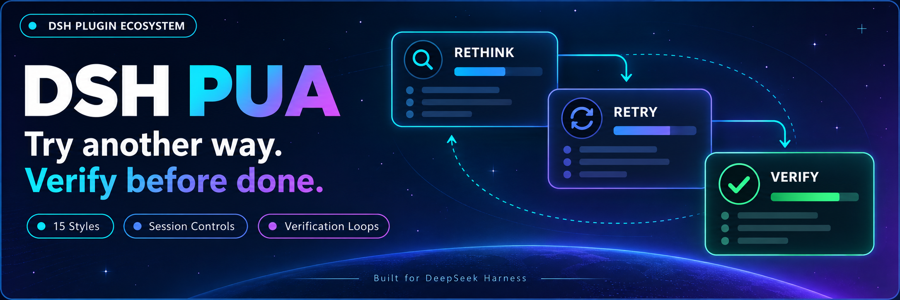
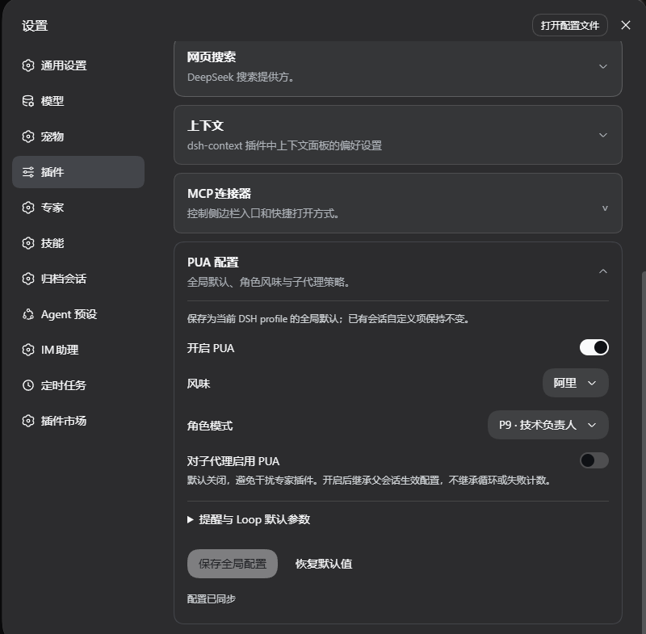
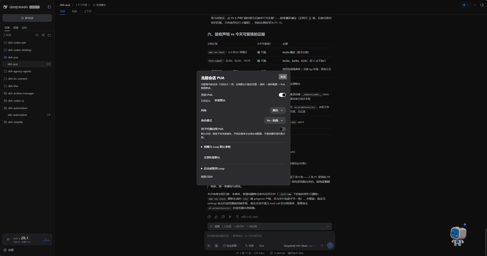

<p align="center">
  
</p>

<div align="center">

# DSH PUA

**エージェントに別の方法を試させ、完了と宣言する前に検証を促します**

[简体中文](README.zh-CN.md) · [English](README.en.md) · [日本語](README.ja.md) · [Español](README.es.md) · [Français](README.fr.md) · [Deutsch](README.de.md) · [Русский](README.ru.md) · [Português](README.pt.md)

[更新履歴](CHANGELOG.md) · [Apache-2.0](LICENSE)

[](https://www.npmjs.com/package/@michengai/dsh-pua)
[](https://www.npmjs.com/package/@michengai/dsh-pua)
[](https://github.com/MichengAI/dsh-pua/actions/workflows/ci.yml)
[](LICENSE)
[](https://github.com/deepseek-ai/deepseek-harness)
[](https://nodejs.org/)

</div>

> DSH PUA は [オリジナル PUA](https://github.com/tanweai/pua) を DeepSeek Harness に導入するプラグインです。エージェントが失敗を繰り返したり、早すぎる諦めを見せたり、検証なしで完了を宣言した際に、別のアプローチの検討、原因調査、証拠提示を促します。コミュニティ管理のプロジェクトであり、DeepSeek AI や PUA 公式の製品ではありません。

## 機能概要

- **困難に直面した時のアプローチ変更**: 無駄な試行の繰り返しを防ぎ、思考手順の再検討を促します。
- **完了前の証拠チェック**: 「完了と報告したのに未検証」という状態を防ぎ、検証と証拠の提示を求めます。
- **好みのスタイルの選択**: 15 種類の大手テック企業風スタイルに加え、P7、P9、P10、称賛、母親などのペルソナモードに対応。
- **UI による柔軟な調整**: プラグイン設定からグローバル設定を保存し、チャット入力欄から現在のセッションのみを個別に調整可能。
- **検証結果に基づく継続実行**: 検証が成功するか、上限周回数に達するか、キャンセルされるまで修正を継続する Loop を起動可能。
- **不正防止ゲート (Integrity Guard)**: ベンチマークの隠し解答の読み取り（Web 検索を含む）を遮断し、テスト・評価・CI 資産の編集時に注意喚起を注入。
- **Markdown テーブル表示**: ステータス表、進捗表、KPI カードは Unicode 罫線ではなく DSH でレンダリング可能な GFM パイプテーブルを採用。

実際の効果は使用するモデルやタスクに依存し、常に解決を保証するものではありません。

## スクリーンショット

### グローバル設定

サイドバーの「プラグイン」から `@michengai/dsh-pua` を開き、デフォルトの有効化、スタイル、ペルソナ、サブエージェント設定を調整して保存します。旧バージョンの DSH では「設定 → プラグイン」の「PUA 設定」から展開します。



### 現在のセッション設定

チャット入力欄のエキスパート入口右側にある **PUA** をクリックして、現在のセッションを個別に調整します。変更項目はデフォルトに戻すことができ、パネル内から Loop の開始やキャンセルも行えます。



## DSH 製品エコシステム

デスクトップワークベンチをご希望の場合は [DSH Codex Desktop](https://github.com/MichengAI/dsh-codex-desktop/releases) をダウンロードしてください。すでに [DeepSeek Harness](https://github.com/deepseek-ai/deepseek-harness) 環境をお持ちの場合は、各プロジェクトの README に従って個別にインストールできます。以下は 11 種類の自社開発プラグイン一覧です。実際の同梱状況は各バージョンのリリースノートおよび内蔵カタログをご確認ください。

| プラグイン | 主な用途 |
| --- | --- |
| [Codex UI](https://github.com/MichengAI/dsh-codex-ui) | プロジェクトとセッションの整理、タスク検索、会話履歴の切り替え |
| [Agency Agents](https://github.com/MichengAI/dsh-agency-agents) | タスクに応じた専門エージェントの選定と呼び出し |
| [Skills Manager](https://github.com/MichengAI/dsh-skills-manager) | ローカルスキルの検索、有効化/無効化、新規作成、インポート |
| [Archive Manager](https://github.com/MichengAI/dsh-archive-manager) | アーカイブされたセッションの検索、復元、整理 |
| [IM Connect](https://github.com/MichengAI/dsh-im-connect) | メッセージングプラットフォームからのタスク投入と返信受信 |
| [Automation](https://github.com/MichengAI/dsh-automation) | スケジュールに基づくタスクの実行と実行ログの確認 |
| [BTW](https://github.com/MichengAI/dsh-btw) | メインタスクを中断せずに現在のコンテキストで一時的な質問を行う |
| [Simplify](https://github.com/MichengAI/dsh-simplify) | `/simplify` コマンドで Git 変更範囲のコードを整理・簡素化 |
| [PUA](https://github.com/MichengAI/dsh-pua) | 失敗時のアプローチ変更、原因究明、完了前の検証実施をエージェントに促す |
| [Code Review](https://github.com/MichengAI/dsh-code-review) | `/review` で独立エージェントによるコードレビューを実行し現在の会話で結果を受信 |
| [Codex Pet](https://github.com/MichengAI/dsh-codex-pet) | デスクトップペットを通じてセッション通知を確認し、ツール承認や質問に回答 |

## インストール

Node.js 22.19 以降が必要です。対応ホスト：DeepSeek Harness `0.2.x` 全シリーズ（`>=0.2.0-rc.1 <0.3.0-0`）。`0.2.0-rc.1`、`0.2.0-rc.2`、`0.2.1-rc.1`、`0.2.1-rc.2`、`0.2.1-rc.3`、`0.2.2-rc.1`、`0.2.2-rc.2` で検証済みであり、以後の `0.2.x` RC 版にもそのまま対応します。`0.2.0-rc.1` より前の旧ホストはサポート外です。`0.3.0` 世代の破壊的変更はバージョンゲートで遮断されます。`0.1.x` をご利用の場合はプラグイン `0.3.28` をインストールしてください。既存の設定とセッション履歴は保持されます。DSH 既存のモデル設定を利用するため、追加の API キーは不要です。

GitHub および npm の両方にビルド済み `lib` が含まれています。ソース変更後はコミット前に `npm run build` を実行してください。

以下の例は `web` プロファイルを使用しています。ご利用のプロファイル名に置き換えてください。

### エージェントに依頼してインストール

ローカルのターミナルを操作できるエージェントに次の文を送信してください：

```text
@michengai/dsh-pua をローカルの web プロファイルにインストールしてください。dsh plugin --profile web add @michengai/dsh-pua@latest --registry=https://registry.npmjs.org/ を実行し、プラグインが読み込まれたことを確認して、PUA 設定の開き方を教えてください。
```

### 手動インストール

```powershell
[Console]::OutputEncoding = [System.Text.Encoding]::UTF8
$OutputEncoding = [System.Text.Encoding]::UTF8
dsh plugin --profile web add @michengai/dsh-pua@latest --registry=https://registry.npmjs.org/
```

実行中のタスク完了後、DSH をリロードするか Web サービスを再起動してください（ブラウザのリロードのみでは反映されません）。`/pua help` を実行してプラグインが利用可能か確認できます。

## 使い方

1. サイドバーの「プラグイン」から `@michengai/dsh-pua` を開き、パッケージ詳細または `michengai-pua` 行の設定を開きます（旧 DSH では「設定 → プラグイン」の「PUA 設定」）。
2. 「PUA の使用を許可」をオンにし、スタイルやペルソナを選択して保存します（この段階では `/pua` とチャット入口が表示されるだけで、自動注入はされません）。
3. チャットに戻り、`/pua` または入力欄入口で現在のセッションを有効にしてからタスクを送信します。

入力欄のエキスパート入口右側に **PUA** が表示されます。現在のセッションでオフのときは電源アイコンになり、テキストに取り消し線は付きません。グローバルで無効化されると入口全体が非表示になります。

## 設定

**グローバルスイッチは `/pua` コマンドおよびチャット入口の表示可否のみを制御します。チャット操作やコマンドは現在のセッションにのみ影響し、デフォルトはオフです。**

アップグレード後、明示的にオン/オフを設定していなかった古いセッションはオフに戻り、自動注入は継続しません。`/pua on`、`/pua off`、またはチャット入口で変更したセッションは保存された状態を維持します。

変更されていない項目はグローバル設定を継承します。設定を変更するとその項目のみがオーバーライドされます。「デフォルトに戻す」でグローバル値に再追従させるか、すべての項目を一括リセットできます。

| 項目 | 説明 |
| --- | --- |
| PUA の使用を許可 | コマンドとチャット入口を制御。デフォルトで許可。オフにすると両方が非表示になり、個別セッションでの有効化もブロック（自動注入は行われません） |
| セッションスイッチ | デフォルトはオフ。`/pua` またはチャット入口で現在のセッションのみ有効化 |
| スタイルとペルソナ | 自動選定、または特定の企業スタイルとペルソナモードを指定 |
| UI 言語 | ホストの言語に自動追従、または中国語 / 英語 / 日本語 / スペイン語 / フランス語 / ドイツ語 / ロシア語 / ポルトガル語に固定 |
| サブエージェントでの有効化 | デフォルトはオフ。エキスパートなどのサブエージェントにも PUA を適用する場合に有効化 |
| 修正リマインダー | ターミナル異常検知、失敗エスカレーション、品質是正リマインダーの調整 |
| 不正防止ゲート | デフォルトはオフ。有効時、ベンチマークの隠し解答の読み取りを拒否し、テスト・評価・CI 資産編集時に注意喚起を注入 |
| フィードバックリマインダー | リマインダー頻度の変更または無効化。フィードバックデータは外部送信されません |
| Loop デフォルト設定 | 検証コマンド、タイムアウト秒数、周回上限の設定 |

`0.3.0` 以降、コマンドによるグローバル設定の変更は廃止されました。サブエージェントの有効化も親セッションの PUA スイッチに依存します。

### 検証が通過するまでタスクを継続

チャットの PUA パネルで、Loop タスク、検証コマンド、周回上限を入力して開始します。たとえば、エージェントにテストの失敗を修正させ、`npm test` で検証し、最大 10 回で停止するよう指定できます。

コマンドからも入力可能です：

```text
/pua loop "テストの失敗を修正し回帰テストを追加してください" --verify "npm test" --max-iterations 10
```

停止するには `/pua-cancel-loop` または `/pua cancel-loop` を入力します。現在のセッションで PUA を無効化した場合も Loop はキャンセルされます（すでに実行された操作は取り消されません）。

Loop 使用時は検証コマンドと周回上限を設定してください。検証コマンドが空の場合、完了判定はモデルの報告に委ねられます。周回上限 0 は無制限を意味します。

## 主なコマンド

日常的な切り替えやスタイル選択は UI から操作可能なため、コマンドの暗記は必須ではありません。

| 目的 | コマンド |
| --- | --- |
| このセッションで PUA を有効化 / 無効化 | `/pua on`, `/pua off` |
| スタイルの指定 | `/pua flavor huawei` |
| 別の方法での再試行を要求 | `/pua again` |
| タスク完了状態の検証を要求 | `/pua done-check` |
| 納品証拠の提示を要求 | `/pua evidence` |
| コードを変更せずに差分レビューを依頼 | `/pua review` |
| このセッションの設定をグローバルデフォルトに戻す | `/pua reset` |
| 検証 Loop をキャンセル | `/pua-cancel-loop`, `/pua cancel-loop` |
| 状態確認または詳細ヘルプの表示 | `/pua status`, `/pua help` |

## セッションイベント

本プラグインは独自のイベントタイプを追加しません。ホストは再生時に未知の必須イベントを拒否し、append には無視フラグが存在しないためです。プラグインが記録するメモは、通常の `role: "user"` を持つ `user/message` イベントとして記録されます。`type` 単体でユーザーの発言回数をカウントしないでください。

判別には `data.source` を使用します：

| 発生源 | 現行ホスト (フォーマット v4 以降) | 旧ホスト |
| --- | --- | --- |
| ランタイムメモと保存された観察記録 | `kind` は `plugin:@michengai/dsh-pua/runtime` | `kind` は `plugin`、`plugin` は `@michengai/dsh-pua/runtime` |
| `/pua` で送信されキューに入ったテキスト | `kind` は `plugin:@michengai/dsh-pua` | `kind` は `plugin`、`plugin` は `@michengai/dsh-pua` |

正規のユーザーメッセージは `source.kind === "user"` となります。

## アンインストール

```powershell
[Console]::OutputEncoding = [System.Text.Encoding]::UTF8
$OutputEncoding = [System.Text.Encoding]::UTF8
dsh plugin --profile web remove @michengai/dsh-pua
```

変更を反映するには DSH を再読み込みしてください。プロジェクトファイルと会話履歴はそのまま保持されます。

## ライセンスと帰属表示

[tanweai/pua](https://github.com/tanweai/pua) 3.5.1 から移植されています。ペルソナおよび協調機能は DSH の対応状況に準じます。

本プロジェクトのオリジナルコードは [Apache License 2.0](LICENSE) の下で公開されています。同梱の PUA アセットはアップストリームの MIT ライセンスおよび帰属表示を継承しています。詳細は [NOTICE](NOTICE) をご覧ください。
