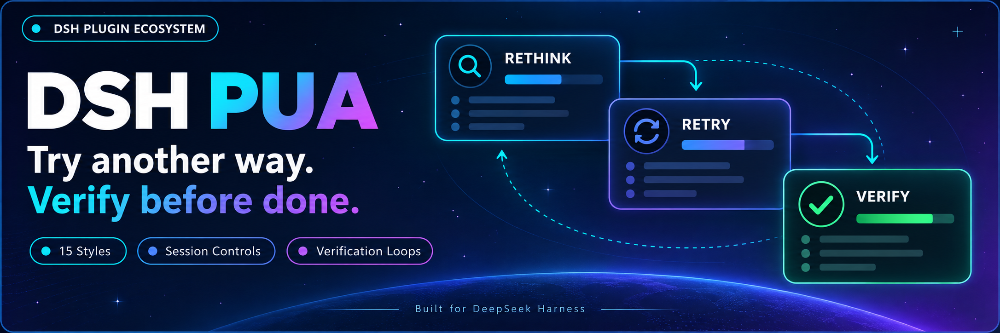

<p align="center">
  
</p>

<div align="center">

# DSH PUA — English fork (dsh-pua-en)

**Help your agent try another approach and verify its work before calling it done.**

[](https://github.com/phucnd0604/dsh-pua-en/actions/workflows/ci.yml)
[](LICENSE)
[](https://github.com/MichengAI/dsh-pua)
[](https://nodejs.org/)

</div>

> English fork of [MichengAI/dsh-pua](https://github.com/MichengAI/dsh-pua), based on
> upstream 1.0.1 with vendored content from [tanweai/pua](https://github.com/tanweai/pua) 3.5.1.
> DSH PUA brings PUA to DeepSeek Harness. When an agent repeatedly fails, gives up too early,
> or claims completion without checking, it pushes a different approach, investigation, and
> evidence. Community-maintained; not an official DeepSeek AI or PUA product.

## Why this fork

The upstream plugin serves Chinese as the primary language of agent-facing content
(methodology docs, narration, hooks, error text). This fork translates that entire surface
to English — vendored assets, hooks, and TypeScript strings included — so it can be used
**instead of** the Chinese original as a daily driver. The PUA tone is preserved; proper
nouns are romanized per [GLOSSARY.md](GLOSSARY.md). Command names are unchanged
(slash commands like /pua, /ding, /mama, /kpi, /p7); descriptions and content are English.

## Features

- **Try another approach**: prompt the agent to reconsider its reasoning instead of repeating ineffective attempts.
- **Check before claiming completion**: encourage verification and evidence for the result.
- **Choose a style**: 15 company-inspired styles, plus P7, P9, P10, encouragement, motherly, and other persona modes.
- **Configure through the UI**: save global settings in plugin settings and adjust individual conversations from chat.
- **Continue based on verification**: start a Loop to keep working until verification passes, the iteration limit is reached, or you cancel.
- **Integrity guard**: deny reads of hidden benchmark answers, including web searches for them, and remind before edits touch test, scoring, or CI assets.
- **Markdown tables**: status, progress, and KPI panels use GFM pipe tables that DSH can render, instead of Unicode box drawings.

Results depend on the model and task. The plugin does not guarantee a solution every time.

## Installation

Requires Node.js 22.19 or later. This fork is tested with DeepSeek Harness 0.2.0-rc.1,
0.2.0-rc.2, 0.2.1-rc.1, and 0.2.1-rc.2. Hosts before 0.2.0, including intermediate
0.2.1 alphas, are rejected by the version gate, and this plugin will not run. If you still
use a 0.1.x host, install upstream plugin 0.3.28 instead. Uses your existing DSH model
configuration; no additional API key is needed. This fork installs by repository — no npm
registry publish is involved.

```powershell
[Console]::OutputEncoding = [System.Text.Encoding]::UTF8
$OutputEncoding = [System.Text.Encoding]::UTF8
dsh plugin --profile web add github:phucnd0604/dsh-pua-en
```

After the current task finishes, reload DSH or restart its Web service. Refreshing the
browser alone is not enough. Enter `/pua help` to check that the plugin is available.

## Usage

1. Open Plugins in the sidebar, open `@phucnd0604/dsh-pua-en`, and use the package page or the `phucnd0604-pua-en` row. On earlier DSH hosts, expand PUA Configuration under Settings → Plugins.
2. Turn on Allow PUA, choose a style and persona, and save. This only shows `/pua` and the chat entry. It does not inject by itself.
3. Return to chat, turn the current conversation on with `/pua` or the chat entry, then submit the task.

**PUA** appears to the right of Experts in the composer. Click it to view or adjust the current conversation. When that conversation is off, the icon is a power symbol and the label is not struck through; disabling it globally hides the entry.

## Configuration

**The global switch only controls whether `/pua` and the chat entry are available. Chat controls and commands affect only the current conversation, which starts off.**

After upgrading, older conversations that were never explicitly turned on or off also return to off. They do not keep injecting. Conversations changed with `/pua on`, `/pua off`, or the chat entry keep their saved switch.

Unchanged options follow global defaults. Editing an option overrides just that option. Choose Restore default to follow the global value again, or restore all options at once.

| Option | What it does |
| --- | --- |
| Allow PUA | Controls the command and chat entry. Allowed by default; turning it off hides both and blocks this conversation from being turned on. It does not inject by itself |
| Conversation switch | Off by default. `/pua` or the chat entry turns injection on for this conversation only |
| Style and persona | Select a style automatically or choose a specific style and persona |
| UI language | Follow the host language automatically, or pin Chinese / English |
| Enable for subagents | Off by default; enable when specialists and other subagents should also use PUA |
| Correction reminders | Adjust terminal checks, failure escalation, and quality reminders |
| Integrity guard | Off by default; when on, deny reads of hidden benchmark answers and remind when edits touch test, scoring, or CI assets |
| Feedback reminders | Change reminder frequency or turn reminders off; feedback is not uploaded |
| Loop defaults | Set a verification command, timeout, and iteration limit |

### Continue until verification passes

In the chat PUA panel, enter a Loop task, verification command, and iteration limit, then start it. For example, ask the agent to fix failing tests, verify with `npm test`, and stop after at most 10 iterations.

You can also enter:

```text
/pua loop "Fix the failing tests and add regression coverage" --verify "npm test" --max-iterations 10
```

Enter `/pua-cancel-loop` or `/pua cancel-loop` to stop. Disabling PUA for the current conversation also cancels its Loop, but does not undo operations already performed.

## Common commands

Everyday switches, styles, and personas are available in the UI; memorizing commands is optional.

| Goal | Command |
| --- | --- |
| Enable or disable PUA for this conversation | `/pua on`, `/pua off` |
| Choose a style | `/pua flavor huawei` |
| Ask for another approach | `/pua again` |
| Check whether the task is complete | `/pua done-check` |
| Check delivery evidence | `/pua evidence` |
| Review current changes without editing | `/pua review` |
| Restore global defaults for this conversation | `/pua reset` |
| Cancel a verification Loop | `/pua-cancel-loop`, `/pua cancel-loop` |
| View status or full usage | `/pua status`, `/pua help` |

## Session events

This plugin does not add a custom event type. The host rejects unknown required events on replay, and append has no ignorable flag. Notes written by the plugin are ordinary `user/message` events with `role: "user"`. Do not count a user turn from `type` alone.

Tell them apart with `data.source`:

| Origin | Current hosts (session format 4 or newer) | Older hosts |
| --- | --- | --- |
| Runtime notes and saved observations | `kind` is `plugin:@phucnd0604/dsh-pua-en/runtime` | `kind` is `plugin` and `plugin` is `@phucnd0604/dsh-pua-en/runtime` |
| Text submitted with `/pua` and then queued as a follow-up or steer | `kind` is `plugin:@phucnd0604/dsh-pua-en` | `kind` is `plugin` and `plugin` is `@phucnd0604/dsh-pua-en` |

A real user message has `source.kind === "user"`.

Each saved runtime observation leaves two `user/message` events in the raw log. The first carries the `PUA_RUNTIME_V1` prefix and JSON so recovery can read it. The second is a surface replace of that same sequence; the model-visible text is only the short note. The second event is not another user turn. The raw JSON stays in the log and is not part of the replaced model surface.

## Uninstall

```powershell
[Console]::OutputEncoding = [System.Text.Encoding]::UTF8
$OutputEncoding = [System.Text.Encoding]::UTF8
dsh plugin --profile web remove @phucnd0604/dsh-pua-en
```

Reload DSH for the change to take effect. Project files and conversation history are preserved.

## License and attribution

Adapted from [MichengAI/dsh-pua](https://github.com/MichengAI/dsh-pua) (which vendors
[tanweai/pua](https://github.com/tanweai/pua) 3.5.1). Original plugin code uses
[Apache License 2.0](LICENSE). Bundled PUA assets retain their upstream-declared MIT
license and attribution; see [NOTICE](NOTICE). Original Chinese bytes are pinned in
assets/pua/upstream.json (sourceSha256/gitBlobSha256); current English bytes are pinned
as contentSha256 and checked by the verify script.
