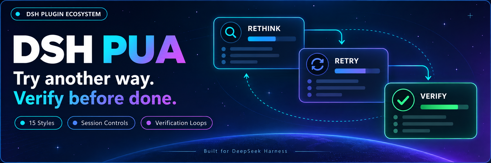
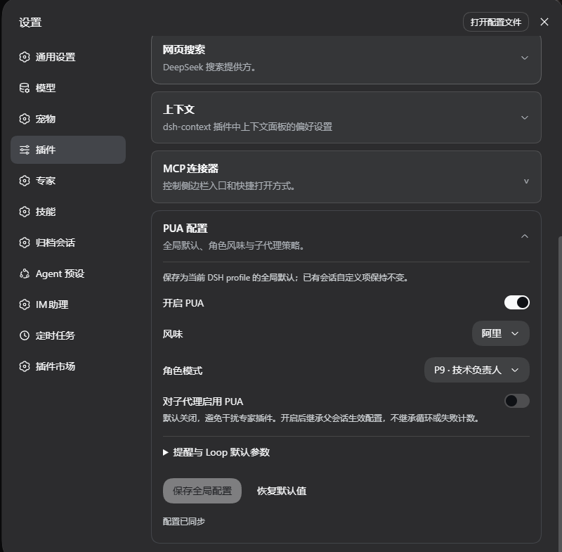
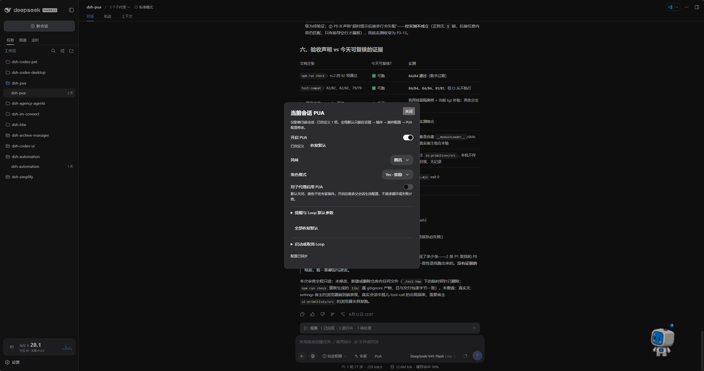

<p align="center">
  
</p>

<div align="center">

# DSH PUA

**Ajude o seu agente a tentar outra abordagem e a verificar o trabalho antes de declará-lo concluído**

[简体中文](README.zh-CN.md) · [English](README.en.md) · [日本語](README.ja.md) · [Español](README.es.md) · [Français](README.fr.md) · [Deutsch](README.de.md) · [Русский](README.ru.md) · [Português](README.pt.md)

[Histórico de alterações](CHANGELOG.md) · [Apache-2.0](LICENSE)

[](https://www.npmjs.com/package/@michengai/dsh-pua)
[](https://www.npmjs.com/package/@michengai/dsh-pua)
[](https://github.com/MichengAI/dsh-pua/actions/workflows/ci.yml)
[](LICENSE)
[](https://github.com/deepseek-ai/deepseek-harness)
[](https://nodejs.org/)

</div>

> O DSH PUA adapta o projeto original [PUA](https://github.com/tanweai/pua) para o DeepSeek Harness. Quando um agente falha repetidamente, desiste antes da hora ou afirma que terminou uma tarefa sem testá-la, este plugin o orienta a repensar a estratégia, investigar as falhas e fornecer evidências verificáveis. Mantido pela comunidade; não é um produto oficial da DeepSeek AI ou do PUA.

## Visão geral

- **Mudar de abordagem perante obstáculos**: Estimula o agente a reconsiderar hipóteses em vez de insistir em tentativas ineficazes.
- **Verificar antes de concluir**: Exige validações reais dos resultados, evitando falsas declarações de conclusão.
- **15 estilos corporativos e personas**: Suporta estilos inspirados nas maiores empresas de tecnologia e papéis como P7, P9, P10, encorajamento e materno.
- **Configuração visual na interface**: Salve preferências globais nos ajustes de plugins e controle conversas individuais diretamente pelo chat.
- **Executar até a verificação passar (Loop)**: Inicia um ciclo de trabalho que prossegue até que os testes passem, o limite de iterações seja atingido ou a ação seja cancelada.
- **Proteção de integridade (Integrity Guard)**: Bloqueia a leitura ou busca web de respostas ocultas em benchmarks e alerta quando testes, avaliações ou CI são alterados.
- **Tabelas em Markdown limpo**: Cartões de status, progresso e KPIs usam tabelas GFM compatíveis com DSH, sem desenhos de caixas Unicode.

Os resultados dependem do modelo e da tarefa; o plugin não garante solução em 100% dos casos.

## Capturas de tela

### Configurações globais

Abra «Plugins» na barra lateral e acesse `@michengai/dsh-pua` para definir ativação padrão, estilo, persona e subagentes. Em versões anteriores do DSH, acerte as opções em Ajustes → Plugins → Configuração de PUA.



### Configuração da sessão atual

Clique em **PUA** à direita de Especialistas na barra do compositor para personalizar a conversa ativa. É possível redefinir valores para o padrão ou iniciar/cancelar Loops neste painel.



## Ecossistema de produtos DSH

Para um ambiente de trabalho completo em desktop, baixe o [DSH Codex Desktop](https://github.com/MichengAI/dsh-codex-desktop/releases). Se já possui o [DeepSeek Harness](https://github.com/deepseek-ai/deepseek-harness), instale plugins individualmente seguindo o README de cada projeto. Abaixo listamos 11 plugins desenvolvidos pela iniciativa; consulte as notas de versão do aplicativo de desktop para os pacotes integrados.

| Plugin | O que você pode fazer |
| --- | --- |
| [Codex UI](https://github.com/MichengAI/dsh-codex-ui) | Organizar projetos e sessões, buscar tarefas e navegar pelas mensagens |
| [Agency Agents](https://github.com/MichengAI/dsh-agency-agents) | Escolher e invocar especialistas dedicados a cada tarefa |
| [Skills Manager](https://github.com/MichengAI/dsh-skills-manager) | Localizar, ativar, criar e importar habilidades locais |
| [Archive Manager](https://github.com/MichengAI/dsh-archive-manager) | Pesquisar, restaurar ou limpar conversas arquivadas |
| [IM Connect](https://github.com/MichengAI/dsh-im-connect) | Enviar tarefas e receber respostas através de mensageiros |
| [Automation](https://github.com/MichengAI/dsh-automation) | Agendar tarefas periódicas e acompanhar o histórico de execuções |
| [BTW](https://github.com/MichengAI/dsh-btw) | Fazer perguntas paralelas sem interromper a execução principal |
| [Simplify](https://github.com/MichengAI/dsh-simplify) | Usar `/simplify` para refatorar e organizar alterações no Git |
| [PUA](https://github.com/MichengAI/dsh-pua) | Orientar o agente a tentar novas abordagens após falhas e verificar entregas |
| [Code Review](https://github.com/MichengAI/dsh-code-review) | Solicitar revisão de código independente com `/review` na conversa atual |
| [Codex Pet](https://github.com/MichengAI/dsh-codex-pet) | Ver alertas e aprovar chamadas de ferramentas através de um pet virtual |

## Instalação

Requer Node.js 22.19 ou posterior. Compatibilidade com a série DeepSeek Harness `0.2.x` (`>=0.2.0-rc.1 <0.3.0-0`), homologado em `0.2.0-rc.1`, `0.2.0-rc.2`, `0.2.1-rc.1`, `0.2.1-rc.2`, `0.2.1-rc.3`, `0.2.2-rc.1`, `0.2.2-rc.2`. Versões anteriores a `0.2.0-rc.1` não são suportadas. Incompatibilidades da versão `0.3.0` são interceptadas pela faixa de dependências. Usuários de ambientes `0.1.x` devem instalar o plugin `0.3.28`. Dados de configuração e histórico de mensagens são preservados. Utiliza a configuração de modelos existente no DSH sem necessidade de chaves de API adicionais.

O GitHub e o npm contêm a pasta compilada `lib`. Caso edite o código-fonte, execute `npm run build` antes de realizar o commit.

Os comandos abaixo utilizam o perfil `web`. Adapte conforme o perfil em uso.

### Pedir para um agente instalar

Envie o texto a seguir para um agente com permissão de terminal no seu computador:

```text
Instale @michengai/dsh-pua no meu perfil web local do DSH executando dsh plugin --profile web add @michengai/dsh-pua@latest --registry=https://registry.npmjs.org/. Verifique se o plugin carregou corretamente e me ensine como abrir as configurações de PUA.
```

### Instalação manual

```powershell
[Console]::OutputEncoding = [System.Text.Encoding]::UTF8
$OutputEncoding = [System.Text.Encoding]::UTF8
dsh plugin --profile web add @michengai/dsh-pua@latest --registry=https://registry.npmjs.org/
```

Após o término das tarefas em andamento, recarregue o DSH ou reinicie o serviço Web (apenas atualizar a página do navegador não é suficiente). Execute `/pua help` para checar a disponibilidade.

## Como usar

1. Abra Plugins na barra lateral, selecione `@michengai/dsh-pua` e abra a tela de opções (em versões antigas: Ajustes → Plugins → Configuração de PUA).
2. Ative «Permitir PUA», selecione o estilo e persona desejados e salve. Isso apenas disponibiliza o comando `/pua` e o botão no chat, sem injeção automática.
3. No chat, ative a conversa atual com `/pua on` ou clicando no botão PUA, e envie sua tarefa.

O indicador **PUA** é exibido à direita de Especialistas no compositor. Quando a conversa está desativada, exibe um ícone de desligado sem texto riscado. Se o plugin estiver desativado globalmente, o botão ficará oculto.

## Configuração

**O interruptor global define apenas se o comando `/pua` e o botão de chat estão disponíveis. Alterações no chat afetam exclusivamente a conversa atual, que inicia desativada por padrão.**

Ao atualizar de versões anteriores, sessões que não foram explicitamente ativadas retornarão ao estado desativado para prevenir injeções acidentais. Sessões ativadas via `/pua on` mantêm seu estado.

| Opção | Descrição |
| --- | --- |
| Permitir PUA | Controla o comando e o botão no chat. Permitido por padrão; ao desativar, ambos são ocultados |
| Interruptor de sessão | Desativado por padrão. Ativa a injeção exclusivamente para a conversa atual |
| Estilo e persona | Escolha automática ou seleção de um estilo corporativo e modo específico |
| Idioma da interface | Acompanha o idioma do host automaticamente ou fixa em chinês / inglês / japonês / espanhol / francês / alemão / russo / português |
| Habilitar em subagentes | Desativado por padrão; ative se deseja que especialistas herdem as diretrizes do PUA |
| Lembretes de correção | Ajusta alertas de erros em terminal, escalonamento de falhas e qualidade |
| Proteção de integridade | Desativado por padrão; bloqueia leitura de gabaritos e alerta sobre edição de testes/CI |
| Lembretes de avaliação | Frequência de lembretes locais; dados permanecem na máquina |
| Padrões do Loop | Comando de validação, tempo limite em segundos e teto de iterações |

### Executar até a verificação passar (Loop)

No painel de PUA do chat, insira a tarefa do Loop, o comando de verificação e o limite de rodadas. Por exemplo, instrua o agente a corrigir testes quebrados, validar com `npm test` e parar após 10 tentativas.

Comando alternativo:

```text
/pua loop "Corrija os testes quebrados e adicione cobertura de regressão" --verify "npm test" --max-iterations 10
```

Para interromper, digite `/pua-cancel-loop` ou `/pua cancel-loop`. Desativar o PUA na sessão atual também cancela o Loop ativo.

## Comandos comuns

Os controles habituais podem ser feitos diretamente pela interface; memorizar comandos é opcional.

| Objetivo | Comando |
| --- | --- |
| Ativar ou desativar PUA nesta conversa | `/pua on`, `/pua off` |
| Definir estilo corporativo | `/pua flavor huawei` |
| Solicitar nova tentativa com abordagem diferente | `/pua again` |
| Exigir validação de conclusão da tarefa | `/pua done-check` |
| Exigir evidências de entrega | `/pua evidence` |
| Revisar alterações sem editar arquivos | `/pua review` |
| Restaurar padrões globais para esta conversa | `/pua reset` |
| Cancelar um ciclo Loop de verificação | `/pua-cancel-loop`, `/pua cancel-loop` |
| Ver status ou ajuda completa | `/pua status`, `/pua help` |

## Eventos de sessão

Este plugin não introduz tipos de eventos customizados para evitar falhas de compatibilidade em recarregamentos. As anotações são salvas como eventos convencionais `user/message` com `role: "user"`. Não contabilize turnos humanos apenas pelo campo `type`.

A distinção é feita pelo campo `data.source`:

| Origem | Hosts atuais (formato de sessão 4+) | Hosts anteriores |
| --- | --- | --- |
| Notas de execução e observações salvas | `kind` é `plugin:@michengai/dsh-pua/runtime` | `kind` é `plugin`, `plugin` é `@michengai/dsh-pua/runtime` |
| Textos enviados via `/pua` e enfileirados | `kind` é `plugin:@michengai/dsh-pua` | `kind` é `plugin`, `plugin` é `@michengai/dsh-pua` |

Mensagens enviadas por usuários humanos reais têm `source.kind === "user"`.

## Desinstalação

```powershell
[Console]::OutputEncoding = [System.Text.Encoding]::UTF8
$OutputEncoding = [System.Text.Encoding]::UTF8
dsh plugin --profile web remove @michengai/dsh-pua
```

Recarregue o DSH para aplicar a remoção. Os arquivos do seu projeto e o histórico de mensagens permanecerão salvos.

## Licença e atribuição

Adaptado do projeto [tanweai/pua](https://github.com/tanweai/pua) 3.5.1. O código original deste projeto é licenciado sob a [Licença Apache 2.0](LICENSE). Os recursos PUA empacotados mantêm sua licença MIT e avisos de atribuição originais; consulte [NOTICE](NOTICE).
