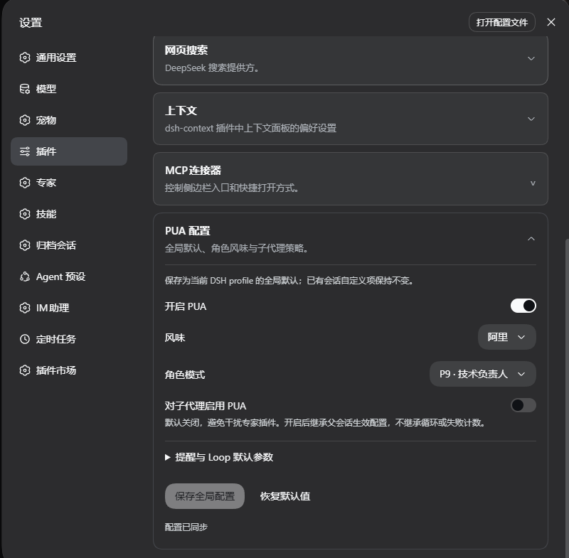
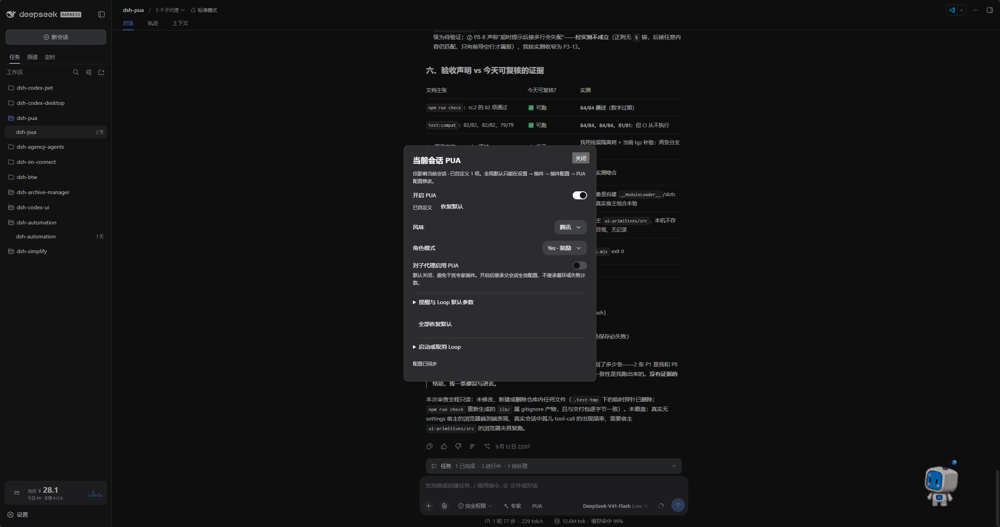

<p align="center">
  
</p>

<div align="center">

# DSH PUA

**Помогите агенту попробовать другой подход и проверить свою работу, прежде чем считать её выполненной.**

[English](README.md) · [简体中文](README.zh-CN.md) · [Возможности](#возможности) · [Скриншоты](#скриншоты) · [Установка](#установка) · [Использование](#использование) · [Настройка](#настройка) · [Команды](#основные-команды) · [События сессии](#события-сессии) · [История изменений](CHANGELOG.md)

[](https://www.npmjs.com/package/@michengai/dsh-pua)
[](https://www.npmjs.com/package/@michengai/dsh-pua)
[](https://github.com/MichengAI/dsh-pua/actions/workflows/ci.yml)
[](LICENSE)
[](https://github.com/deepseek-ai/deepseek-harness)
[](https://nodejs.org/)

</div>

> DSH PUA приносит [PUA](https://github.com/tanweai/pua) в DeepSeek Harness. Когда агент многократно терпит неудачу, сдаётся слишком рано или заявляет о завершении без проверки, плагин поощряет другой подход, исследование и доказательства. Поддерживается сообществом; не является официальным продуктом DeepSeek AI или PUA.

## Возможности

- **Попробовать другой подход**: подтолкнуть агента пересмотреть свои рассуждения вместо повторения неэффективных попыток.
- **Проверить перед заявлением о завершении**: поощрять проверку и доказательства результата.
- **Выбрать стиль**: 15 стилей, вдохновлённых компаниями, а также режимы P7, P9, P10, поощрение, «мама» и другие персоны.
- **Настройка через интерфейс**: сохраняйте глобальные настройки в настройках плагина и меняйте отдельные беседы прямо из чата.
- **Продолжать на основе проверки**: запускайте Loop, чтобы работать, пока проверка не пройдёт, не будет достигнут предел итераций или вы не отмените.
- **Защита целостности**: запрещать чтение скрытых эталонных ответов, включая веб-поиск по ним, и напоминать перед правками тестов, оценочных или CI-ресурсов.
- **Markdown-таблицы**: статус, прогресс и KPI-панели используют GFM pipe-таблицы, которые DSH умеет рендерить, вместо Unicode-рисования.

Результат зависит от модели и задачи. Плагин не гарантирует решение в каждом случае.

## Скриншоты

### Глобальные настройки

Откройте «Плагины» в боковой панели, затем `@michengai/dsh-pua`, чтобы задать включение по умолчанию, стиль, персону и поведение субагентов. Более старые DSH-хосты всё ещё используют Настройки → Плагины → PUA Configuration. На скриншотах показан китайский интерфейс.



### Текущая беседа

Нажмите **PUA** справа от «Эксперты», чтобы настроить текущую беседу. Восстановите отдельные значения по умолчанию или запустите и отмените Loop из той же панели.



## Экосистема продуктов DSH

Для настольной среды скачайте [DSH Codex Desktop](https://github.com/MichengAI/dsh-codex-desktop/releases). Существующие установки [DeepSeek Harness](https://github.com/deepseek-ai/deepseek-harness) могут добавлять плагины по мере необходимости, следуя README каждого проекта. Ниже перечислены 11 сторонних плагинов; смотрите соответствующие примечания к выпускам и встроенный каталог, чтобы узнать, что включает конкретная версия.

| Плагин | Что вы можете делать |
| --- | --- |
| [Codex UI](https://github.com/MichengAI/dsh-codex-ui) | Организовывать проекты и беседы, искать задачи, навигировать по ходам чата |
| [Agency Agents](https://github.com/MichengAI/dsh-agency-agents) | Выбирать и вызывать специалистов для вашей задачи |
| [Skills Manager](https://github.com/MichengAI/dsh-skills-manager) | Находить, включать, создавать и импортировать локальные навыки |
| [Archive Manager](https://github.com/MichengAI/dsh-archive-manager) | Искать, восстанавливать или очищать архивные беседы |
| [IM Connect](https://github.com/MichengAI/dsh-im-connect) | Отправлять задачи и получать ответы через мессенджеры |
| [Automation](https://github.com/MichengAI/dsh-automation) | Планировать задачи и проверять каждый запуск |
| [BTW](https://github.com/MichengAI/dsh-btw) | Задавать побочные вопросы, не прерывая основную задачу |
| [Simplify](https://github.com/MichengAI/dsh-simplify) | Использовать `/simplify` для улучшения кода в ваших изменениях Git |
| [PUA](https://github.com/MichengAI/dsh-pua) | Направлять агента пробовать новые подходы после неудач, исследовать причины и проверять результаты перед завершением |
| [Code Review](https://github.com/MichengAI/dsh-code-review) | Использовать `/review` для запроса независимого код-ревью агентом и получать отчёт в текущей беседе |
| [Codex Pet](https://github.com/MichengAI/dsh-codex-pet) | Просматривать уведомления беседы и отвечать на одобрения инструментов и вопросы через настольного питомца |

## Установка

Требуется Node.js 22.19 или новее и DSH `0.1.2-rc.1`, `0.1.5-rc.1`, `0.1.5-rc.2`, `0.1.5-rc.3`, `0.1.7-rc.1`, `0.1.7-rc.2`, `0.2.0-rc.1`, `0.2.0-rc.2`, `0.2.1-alpha.2` или `0.2.1-alpha.3`. Использует вашу существующую конфигурацию моделей DSH; дополнительный API-ключ не нужен.

GitHub и npm включают готовый к запуску `lib`. После изменения исходников выполните `npm run build` перед коммитом.

В примерах используется профиль `web`. Замените его на тот профиль, которым вы пользуетесь.

### Попросить агента установить плагин

Отправьте это агенту, который может выполнять команды на вашем компьютере:

```text
Install @michengai/dsh-pua into my local DSH web profile by running dsh plugin --profile web add @michengai/dsh-pua@latest --registry=https://registry.npmjs.org/. Check that the plugin loads, then explain how to open PUA settings.
```

### Установка вручную

```powershell
[Console]::OutputEncoding = [System.Text.Encoding]::UTF8
$OutputEncoding = [System.Text.Encoding]::UTF8
dsh plugin --profile web add @michengai/dsh-pua@latest --registry=https://registry.npmjs.org/
```

После завершения текущей задачи перезагрузите DSH или перезапустите его веб-сервис. Простого обновления страницы недостаточно. Введите `/pua help`, чтобы проверить, что плагин доступен.

## Использование

1. Откройте «Плагины» в боковой панели, откройте `@michengai/dsh-pua` и используйте страницу пакета или строку `michengai-pua`. На более старых DSH-хостах разверните PUA Configuration в Настройки → Плагины.
2. Включите «Разрешить PUA», выберите стиль и персону и сохраните. Это лишь показывает `/pua` и вход в чате. Сам по себе он ничего не внедряет.
3. Вернитесь в чат, включите текущую беседу через `/pua` или вход в чате, затем отправьте задачу.

**PUA** появляется справа от «Эксперты» в композере. Нажмите, чтобы просмотреть или настроить текущую беседу. Когда беседа выключена, иконка — это символ питания, а подпись не зачёркнута; глобальное отключение скрывает вход.

## Настройка

**Глобальный переключатель лишь управляет тем, доступны ли `/pua` и вход в чате. Настройки чата и команды влияют только на текущую беседу, которая по умолчанию выключена.**

После обновления более старые беседы, которые никогда явно не включались и не выключались, также возвращаются в состояние «выключено». Они не продолжают внедряться. Беседы, изменённые с помощью `/pua on`, `/pua off` или входа в чате, сохраняют свой сохранённый переключатель.

Неизменённые параметры следуют глобальным значениям по умолчанию. Правка параметра переопределяет только его. Выберите «Восстановить по умолчанию», чтобы снова следовать глобальному значению, или восстановите все параметры сразу.

| Параметр | Что делает |
| --- | --- |
| Разрешить PUA | Управляет командой и входом в чате. Разрешено по умолчанию; отключение скрывает оба и блокирует включение этой беседы. Само по себе ничего не внедряет |
| Переключатель беседы | Выключен по умолчанию. `/pua` или вход в чате включает внедрение только для этой беседы |
| Стиль и персона | Выбрать стиль автоматически или выбрать конкретный стиль и персону |
| Язык интерфейса | Следовать языку хоста автоматически или зафиксировать китайский / английский |
| Включить для субагентов | Выключено по умолчанию; включите, когда специалисты и другие субагенты также должны использовать PUA |
| Напоминания о корректировках | Настроить проверки терминала, эскалацию ошибок и напоминания о качестве |
| Защита целостности | Выключена по умолчанию; при включении запрещает чтение скрытых эталонных ответов и напоминает при правках тестов, оценочных или CI-ресурсов |
| Напоминания об обратной связи | Изменить частоту напоминаний или выключить их; обратная связь не выгружается |
| Значения по умолчанию Loop | Задать команду проверки, таймаут и предел итераций |

Начиная с `0.3.0`, команды больше не изменяют глобальные настройки. Включение субагентов также зависит от переключателя PUA родительской беседы.

### Продолжать, пока проверка не пройдёт

В панели PUA в чате введите задачу Loop, команду проверки и предел итераций, затем запустите. Например, попросите агента исправить падающие тесты, проверить через `npm test` и остановиться не более чем через 10 итераций.

Можно также ввести:

```text
/pua loop "Fix the failing tests and add regression coverage" --verify "npm test" --max-iterations 10
```

Введите `/pua-cancel-loop` или `/pua cancel-loop`, чтобы остановить. Отключение PUA для текущей беседы также отменяет её Loop, но не отменяет уже выполненные операции.

Задайте команду проверки и предел итераций при использовании Loop. Без команды проверки завершение полагается на отчёт модели. Предел итераций 0 означает неограниченные итерации.

## Основные команды

Повседневные переключатели, стили и персоны доступны в интерфейсе; запоминать команды необязательно.

| Цель | Команда |
| --- | --- |
| Включить или выключить PUA для этой беседы | `/pua on`, `/pua off` |
| Выбрать стиль | `/pua flavor huawei` |
| Попросить другой подход | `/pua again` |
| Проверить, выполнена ли задача | `/pua done-check` |
| Проверить доказательства доставки | `/pua evidence` |
| Просмотреть текущие изменения без правок | `/pua review` |
| Восстановить глобальные значения по умолчанию для этой беседы | `/pua reset` |
| Отменить проверочный Loop | `/pua-cancel-loop`, `/pua cancel-loop` |
| Посмотреть статус или полное использование | `/pua status`, `/pua help` |

## События сессии

Этот плагин не добавляет собственный тип события. Хост отклоняет неизвестные обязательные события при воспроизведении, а append не имеет флага игнорирования. Заметки, записанные плагином, являются обычными событиями `user/message` с `role: "user"`. Не считайте пользовательский ход по одному лишь `type`.

Различите их по `data.source`:

| Происхождение | Текущие хосты (формат сессии 4 или новее) | Более старые хосты |
| --- | --- | --- |
| Заметки рантайма и сохранённые наблюдения | `kind` равен `plugin:@michengai/dsh-pua/runtime` | `kind` равен `plugin`, а `plugin` равен `@michengai/dsh-pua/runtime` |
| Текст, отправленный через `/pua` и затем поставленный в очередь как follow-up или steer | `kind` равен `plugin:@michengai/dsh-pua` | `kind` равен `plugin`, а `plugin` равен `@michengai/dsh-pua` |

Настоящее сообщение пользователя имеет `source.kind === "user"`.

Каждое сохранённое наблюдение рантайма оставляет два события `user/message` в сыром журнале. Первое несёт префикс `PUA_RUNTIME_V1` и JSON, чтобы восстановление могло его прочитать. Второе — это поверхностная замена той же последовательности; видимый модели текст — только короткая заметка. Второе событие не является ещё одним пользовательским ходом. Сырой JSON остаётся в журнале и не является частью заменённой модели-видимой поверхности.

## Удаление

```powershell
[Console]::OutputEncoding = [System.Text.Encoding]::UTF8
$OutputEncoding = [System.Text.Encoding]::UTF8
dsh plugin --profile web remove @michengai/dsh-pua
```

Перезагрузите DSH, чтобы изменение вступило в силу. Файлы проекта и история бесед сохраняются.

## Лицензия и атрибуция

Адаптировано из [tanweai/pua](https://github.com/tanweai/pua) 3.5.1. Возможности персон и совместной работы зависят от того, что поддерживает DSH.

Код оригинального проекта использует [Apache License 2.0](LICENSE). Включённые ресурсы PUA сохраняют заявленную апстримом лицензию MIT и атрибуцию; см. [NOTICE](NOTICE).
